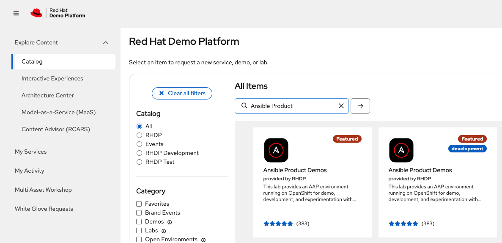
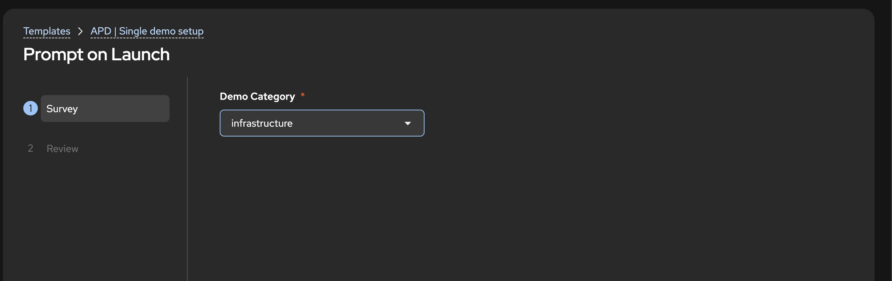
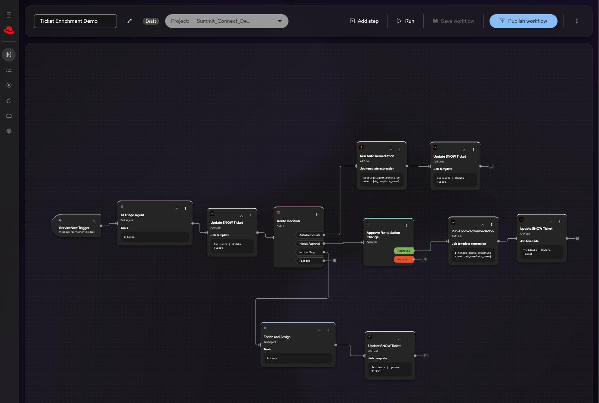
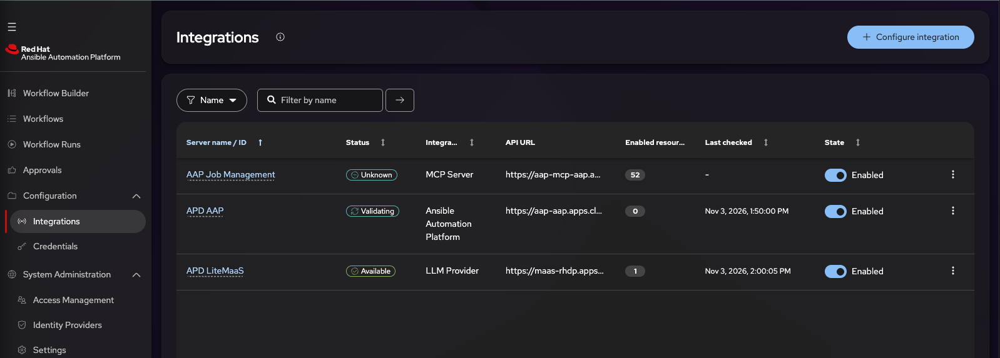
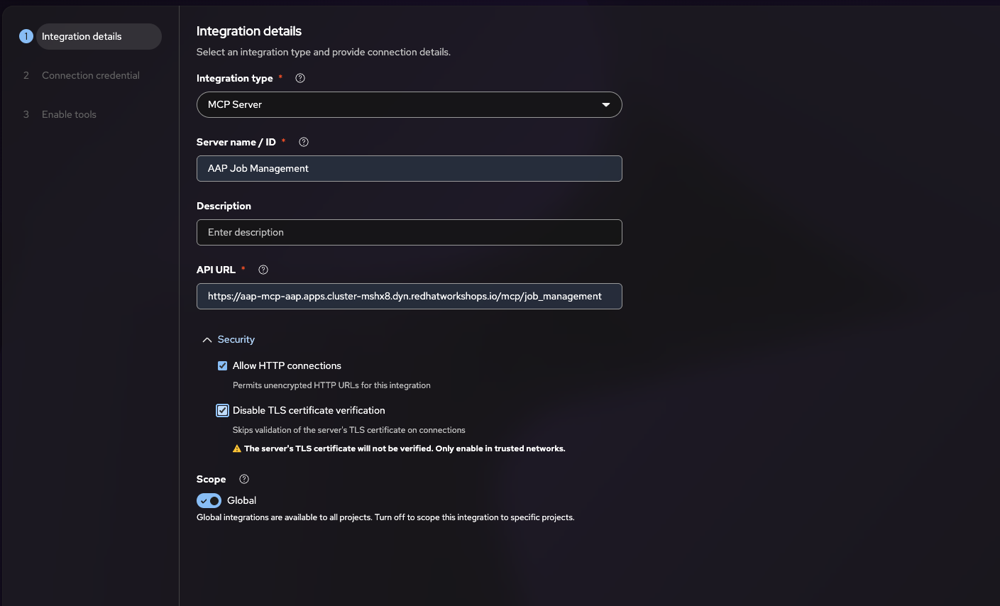
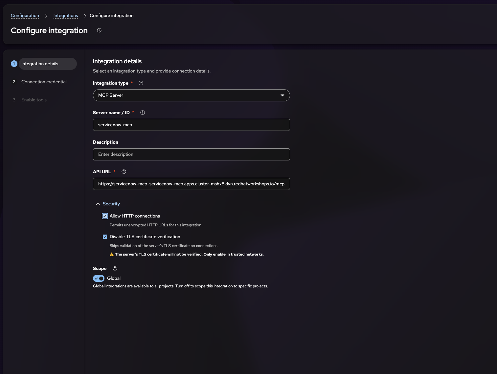

# AAP Automation Orchestrator Demo

This repo contains the code to demostrate the Automation Orchestrator in AAP.  To do so we be implementing the ticket Enrichment demo from the AO side.

We can find create example of Automation Orchestrator [here](https://ansible-tmm.github.io/aap-orchestrator-demos/#block-mcp_integration)

### Reference site and information.

1. https://ansible-tmm.github.io/aap-orchestrator-demos/
2. https://drive.google.com/file/d/1DCLGlCBPm4t4-nOf1f34khBXQkFrzOcl/view?pli=1  reference point 18:30 minutes.
3. https://ansible.github.io/product-demos/demos/automation-orchestrator/

### Provisioning steps.

1. Provision the **Ansible Product Demos** from the [Red Hat Demo Platform](https://catalog.demo.redhat.com/catalog/all)

   
2. Run the template to install the right demo.
   * Login into Ansible Automation Plaform
   * Launch the `ADP | Single Demo setup template` and install the `infrastructure` deme that contains the template for the Automation Orchestrator.
    

    :warning: While the template is running to install what is required, that time to watch and show the available [building block](https://ansible-tmm.github.io/aap-orchestrator-demos/glossary/)
3. Once the install is complete run the right template.
   * Run the `Infrastructure | Automation Orchestrator | Install` 
   * Once the template is complete, retrieve the connection information to the `Automation Orchestrator` in the output window.
    :notebook: You can also retrieve this in the OCP installation in the right project in the secret and network tab.

### Install the AAP MCP server and connect it to Cursor.

This is a nice to have make dealing with Ansible Automation Platform really could in a demo fashion. Fellow the step in this [demo](https://github.com/froberge/aap_mcp_server_demo) to install and have it working.

### Get the Automation Orchestrator going

#### [Ticket Enrichment Demo](ticket-enrichment/README.md)

For this demo we wil be using the [Ticket Enrichment](https://ansible-tmm.github.io/aap-orchestrator-demos/demos/ticket-enrichment/).  

To use this we need to download the JSON and imported it in to our Automation Orchestrator installation. Once it is imported, you need to modify it to connect to the right places. There is also a modify copy found [here](ticket-enrichment/ao/ticket-enrichment.json) 


#### RHEL 9 demo VM (AWS)

The remediation playbooks need a RHEL 9 host in `us-east-1`. Use the `redhat-demo` profile. That account has no default VPC, so `run-instances` without a subnet fails with `VPCIdNotSpecified`. Create the key, a small public network, and then the instance.

1. Create the key pair and save the private key locally. This command prints the private key only once.
   ```bash
    aws ec2 create-key-pair \
      --profile redhat-demo \
      --region us-east-1 \
      --key-name ao-ticket-demo-key \
      --query 'KeyMaterial' --output text > ao-ticket-demo-key.pem
    chmod 600 ao-ticket-demo-key.pem
   ```
2. Create a VPC, a public subnet, and an internet gateway. Keep the IDs the commands print; the launch step needs them.
   ```bash
    VPC_ID=$(aws ec2 create-vpc \
      --profile redhat-demo --region us-east-1 \
      --cidr-block 10.20.0.0/16 \
      --tag-specifications 'ResourceType=vpc,Tags=[{Key=Name,Value=ao-ticket-demo}]' \
      --query 'Vpc.VpcId' --output text)

    aws ec2 modify-vpc-attribute --profile redhat-demo --region us-east-1 \
      --vpc-id "$VPC_ID" --enable-dns-support '{"Value":true}'
    aws ec2 modify-vpc-attribute --profile redhat-demo --region us-east-1 \
      --vpc-id "$VPC_ID" --enable-dns-hostnames '{"Value":true}'

    SUBNET_ID=$(aws ec2 create-subnet \
      --profile redhat-demo --region us-east-1 \
      --vpc-id "$VPC_ID" --cidr-block 10.20.1.0/24 --availability-zone us-east-1a \
      --tag-specifications 'ResourceType=subnet,Tags=[{Key=Name,Value=ao-ticket-demo-public}]' \
      --query 'Subnet.SubnetId' --output text)
    aws ec2 modify-subnet-attribute --profile redhat-demo --region us-east-1 \
      --subnet-id "$SUBNET_ID" --map-public-ip-on-launch

    IGW_ID=$(aws ec2 create-internet-gateway \
      --profile redhat-demo --region us-east-1 \
      --tag-specifications 'ResourceType=internet-gateway,Tags=[{Key=Name,Value=ao-ticket-demo}]' \
      --query 'InternetGateway.InternetGatewayId' --output text)
    aws ec2 attach-internet-gateway --profile redhat-demo --region us-east-1 \
      --internet-gateway-id "$IGW_ID" --vpc-id "$VPC_ID"

    RT_ID=$(aws ec2 create-route-table \
      --profile redhat-demo --region us-east-1 --vpc-id "$VPC_ID" \
      --tag-specifications 'ResourceType=route-table,Tags=[{Key=Name,Value=ao-ticket-demo-public}]' \
      --query 'RouteTable.RouteTableId' --output text)
    aws ec2 create-route --profile redhat-demo --region us-east-1 \
      --route-table-id "$RT_ID" --destination-cidr-block 0.0.0.0/0 --gateway-id "$IGW_ID"
    aws ec2 associate-route-table --profile redhat-demo --region us-east-1 \
      --route-table-id "$RT_ID" --subnet-id "$SUBNET_ID"
   ```
3. Allow SSH from your workstation and from Ansible Automation Platform. Playbooks run in the `default` container group, so the address to allow is the execution pod's public egress, not the controller URL.

   On this cluster that egress is `148.62.110.78`. Confirm it before you rely on it: in Controller, run an ad hoc `shell` of `curl -fsS https://checkip.amazonaws.com` against a host that uses `ansible_connection: local`. The address in the output is the one to authorize.
4. Launch the instance into that subnet. Pass the security group ID, not a group name. `ami-0225644bfadc204f7` is RHEL 9.8 (hourly).
   ```bash
    aws ec2 run-instances \
      --profile redhat-demo \
      --region us-east-1 \
      --image-id ami-0225644bfadc204f7 \
      --instance-type t3.small \
      --key-name ao-ticket-demo-key \
      --subnet-id "$SUBNET_ID" \
      --security-group-ids "$SG_ID" \
      --associate-public-ip-address \
      --metadata-options 'HttpTokens=required,HttpEndpoint=enabled' \
      --tag-specifications 'ResourceType=instance,Tags=[{Key=Name,Value=ao-ticket-demo-vm}]'
   ```
5. Read the public IP from the new instance and connect as `ec2-user`.
   ```bash
    aws ec2 describe-instances \
      --profile redhat-demo --region us-east-1 \
      --filters 'Name=tag:Name,Values=ao-ticket-demo-vm' 'Name=instance-state-name,Values=pending,running' \
      --query 'Reservations[].Instances[].PublicIpAddress' --output text

    ssh -i ao-ticket-demo-key.pem ec2-user@<public-ip>
   ```

    If SSH times out later, your public IP has changed. Authorize the new address on `ao-ticket-demo-ssh` the same way as step 3.

6. Register the instance as an AAP host. Follow [demo-setup/aap-host/README.md](demo-setup/aap-host/README.md).

#### Create an Integration for Ansible Automation Platform MCP Server.

The workflow needs an integration to the Ansible Automation Plaform MCP server that was create in the previous step.

1. Let make the URL available for the integration
    ```
   oc set env \
   deployment/automation-orchestrator-backend \
   deployment/automation-orchestrator-worker \
   deployment/automation-orchestrator-background-worker \
   -n  automation-orchestrator \
   'APP_INTEGRATION_URL_ALLOWED_HOSTS=["THE_MCP_SERVER_URL"]'
   ```
1. Create the Integration in Automation Orchestrator
   
1. Create the Integration with the following details.
  * **Integration Type:** MCP Server 
  * **Server Name/ID:** AAP Job Management
  * **API URL**: [MCP_SERER_URL]/mcp/job_management
  * select Allow HTTP connection 
  * select Disable TLS certificate verification.

  

#### ServiceNow MCP Server

1. We need to create the MCP server in OpenShift for Service Now.
  * Build it, expose the route by following [demo-setup/servicenow-mcp/README.md](demo-setup/servicenow-mcp/README.md).
1. Once it has been created and deploy we need to create a new Integration in Automation Orchestrator.
  * **Integration Type:** MCP Server
  * **Server Name/ID:** `servicenow-mcp`
  * **API URL:** `https://<SERVICENOW_MCP_HOST>/mcp`
  * Select **Allow HTTP connection**
  * Select **Disable TLS certificate verification** when Automation Orchestrator does not trust the cluster route certificate
  * No credential required they are define in the OCP secret.
  
  

#### Run the demo

Before you can run the demo, make sure all the URL are set on the `ALLOW LIST` so automation controller can access them.

```
oc set env \
  deployment/automation-orchestrator-backend \
  deployment/automation-orchestrator-worker \
  deployment/automation-orchestrator-background-worker \
  -n automation-orchestrator \
  'APP_INTEGRATION_URL_ALLOWED_HOSTS=["<AAP_MCP_DOMAIN>","<SERVICE_NOW_MCP_DOMAIN>","<AAP_DOMAIN>"]'
```


Foloow the instruction here to run the demo.
Follow [demo-setup/README.md](demo-setup/README.md).
