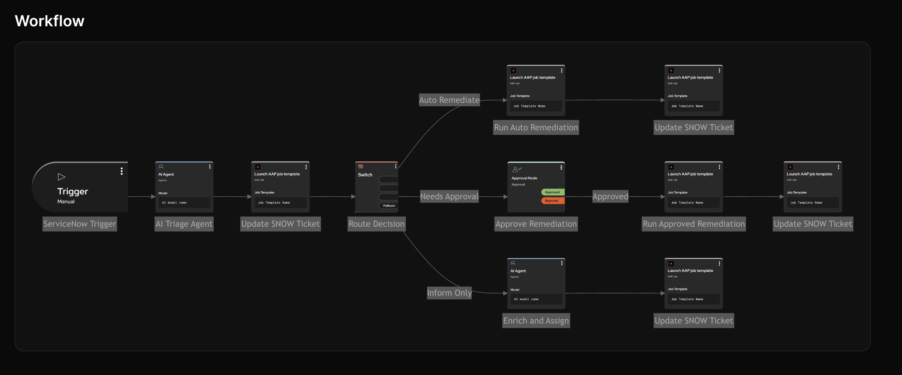
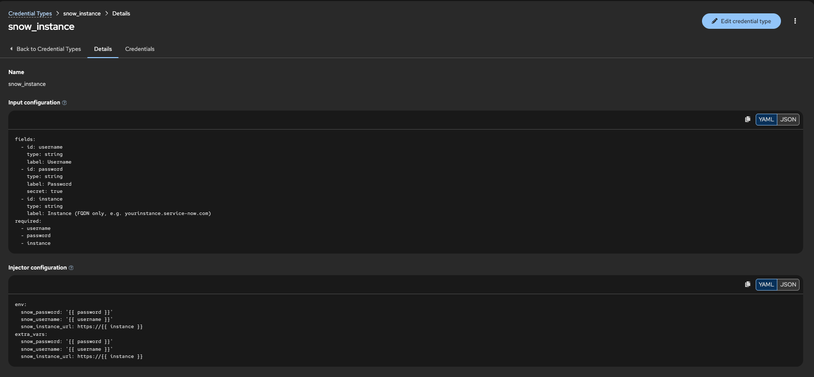
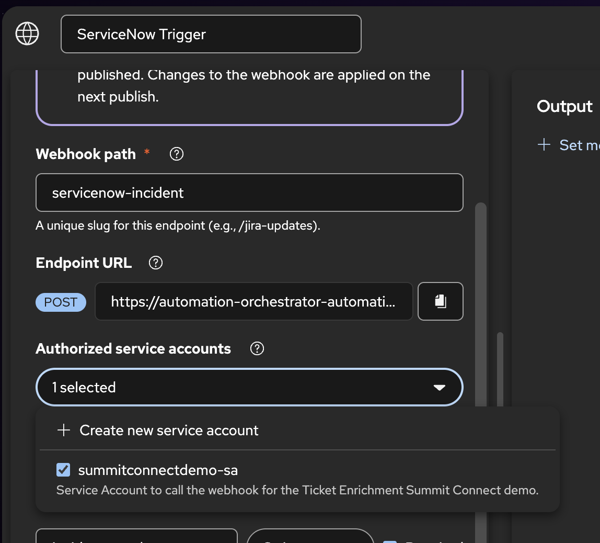
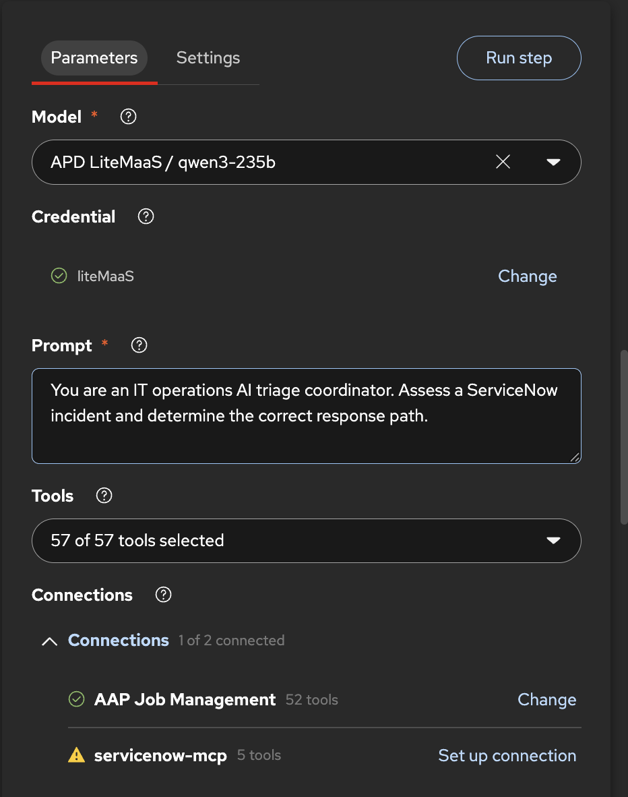

# Run the Ticket Enrichment workflow



Start **Ticket Enrichment Demo** from Automation Orchestrator. The ServiceNow Trigger is a webhook named `servicenow-incident`. A POST to that webhook passes `incident_number` into the workflow.

## Demo setup

Before we can actually run the workflow, there is multiple step that need to be done to finalize the workflow.
:warning: You can only call the webhook on a **published** version of the workflow. So you need to puslish before the first run.

###### Setup AAP
1. Create the required credential.
  - Create a credential to connect to the RHEL machine by SSH. To do so create a credential of type `Machine` with user ec2-user and the SSH Private key created earlier.
1. Create a credential type for ServiceNow.
  
    input configuration
    ```
    fields:
      - id: username
        type: string
        label: Username
      - id: password
        type: string
        label: Password
        secret: true
      - id: instance
        type: string
        label: Instance (FQDN only, e.g. yourinstance.service-now.com)
    required:
      - username
      - password
      - instance
    ```
    injector configuration
    ```
    env:
      snow_password: '{{ password }}'
      snow_username: '{{ username }}'
      snow_instance_url: https://{{ instance }}
    extra_vars:
      snow_password: '{{ password }}'
      snow_username: '{{ username }}'
      snow_instance_url: https://{{ instance }}
    ```
  - Create a credential for the ServiceNow instance of the type just created.
1. Run the scipt [aap-host/create-host](aap-host/create-host.sh) to create an host for thew AWS machine in AAP.
1. Create a project and link to this repo to get the playbook.
1. Import the 3 required playbook
  - The `Update Snow ticket` playbook, requires the credential to connect to the ServiceNow instance created earlier.
  - The `Remediate Disk Cleanup` and `Remediate Process Cleanup` playbook requires the aws credential and the credential to connect to the machine with SSH created earlier.
  - Make sure all template have Prompt on lauch check. 

---

###### Fixing the Workflow
1. Edit the `ServiceNow trigger` step.
  - Setup a service account under **Authorized service accounts**.
  
1. Edit the `AI Triage Agent` step.
  - Add the model and the 2 MCP server for AAP and ServiceNow.
  
1. Edit the `Update Snow Ticket` step before the `Route Decision`.
  - Add the integration to AAP, with the connection credential
  - Add the right Organization to find the playbook
  - Make sure  to the right job template.
  - Change the extra variables to remove the SNOW information
    ```
    { "ticket_id": "${trigger.incident_number}", "notification_body": "${triage_agent.result.content.notification_body}", "notification_title": "${triage_agent.result.content.notification_title}", "snow_ticket_state": "2" }
    ```
1. Edit the other 3 `Update Snow Ticket` step. Notice that the extra variable has change.
  - Add the integration to AAP, with the connection credential
  - Add the right Organization to find the playbook
  - Make sure it the right job template.
  - Change the extra variables to remove the SNOW information
    ```
    { "ticket_id": "${trigger.incident_number}", "notification_body": "${triage_agent.result.content.notification_body}", "notification_title": "${triage_agent.result.content.notification_title}", "snow_ticket_state": "6" }
    ```
1. Edit the `Run Auto Remediation` and `Run Approved Remediation` step.
  - Add the integration to AAP, with the connection credential
  - Add the right Organization to find the playbook
  - Make sure it the right job template.
  

When al this is done you can save the workflow and **publish it**.

---

###### Create the required incident.

In a terminal, first import the require values to run the different scripts needed.
```
export SERVICENOW_INSTANCE_URL=<snow-url>
export SERVICENOW_USERNAME=<snow-username>
export SERVICENOW_PASSWORD=<snow-password>
```

###### Create an auto-remediate incident

`create-incident-autoremidiate.sh` opens a priority 1 disk-cleanup incident. The optional argument is the affected host. The default is `ao-ticket-demo-vm`. ServiceNow leaves the calculated priority at 5 on this instance, so the script sets priority to **1 - Critical** after creating the record. Priority 5 takes the inform-only path.

```
./scripts/create-incident-autoremidiate.sh
```

The printed `number` is the value to pass to `scripts/launch-workflow.sh`. The description asks for log cleanup only, so triage can match **Linux - Remediate - Disk Cleanup**.

###### Create an approval incident

`create-incident-approval.sh` opens a priority 1 high-CPU incident. Process termination is a risky fix, so triage routes it to **Needs Approval** when it matches `ao_demo-remediate_process_cleanup`. The optional argument is the affected host. The default is `ao-ticket-demo-vm`.

```
./scripts/create-incident-approval.sh
```

The description says the fix may interrupt the host and that human review is recommended. It also says this is not a disk cleanup, so the route stays off auto-remediate.

###### Create an inform-only incident

`create-incident-inform-only.sh` opens a priority 5 inquiry. Triage skips remediation templates for priority 4 or 5, so the route is **Inform Only**. The optional argument is the system named in the request. The default is `ao-ticket-demo-vm`.

```
./scripts/create-incident-inform-only.sh
```

The description asks for a backup report and says no cleanup, restart, or process termination is requested.

## Run

`launch-workflow.sh` requests a new service-account token, then posts the incident number to the `servicenow-incident` webhook. Pass the incident number as the first argument. The client ID is the credential **identifier** on the service account. The client secret is shown only when that credential is created or rotated.

```bash
export AO_CLIENT_ID=<client-id>
export AO_CLIENT_SECRET=<client-secret>

./scripts/launch-workflow.sh INCXXXXXX
```

The token lasts about 15 minutes and is not printed. Each run requests a new one. The webhook response includes the workflow execution id. Open that run in Automation Orchestrator and follow it from the trigger into **Update SNOW Ticket**. The Controller job created by that step carries `ticket_id` set to the incident number.

---

###### Nice to know.

The curl method to get a  token
```
curl -sS -X POST \
  -H 'Content-Type: application/x-www-form-urlencoded' \
  --data-urlencode 'grant_type=client_credentials' \
  --data-urlencode 'client_id=<client_id>’ \
  --data-urlencode 'client_secret=client_Secret’ \
  'workflow_webhook_trigger_url/api/v1/auth/token'
```

Webhook trigger.
```
curl -X POST 'https://automation-orchestrator-automation-orchestrator.apps.cluster-mshx8.dyn.redhatworkshops.io/api/v1/webhooks/servicenow-incident' \
  -H 'Authorization: Bearer <TOKEN FROM CALL ABOVE' \
  -H 'Content-Type: application/json' \
  -d '{"incident_number":"INCIDENT_NUMBER"}'
```